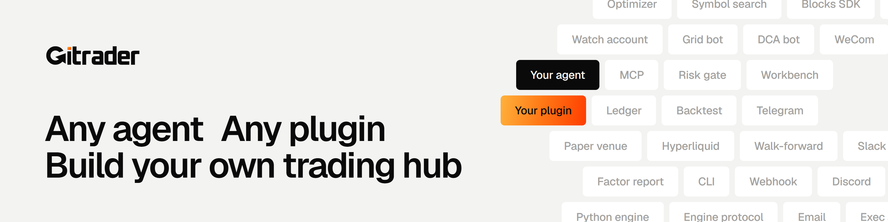
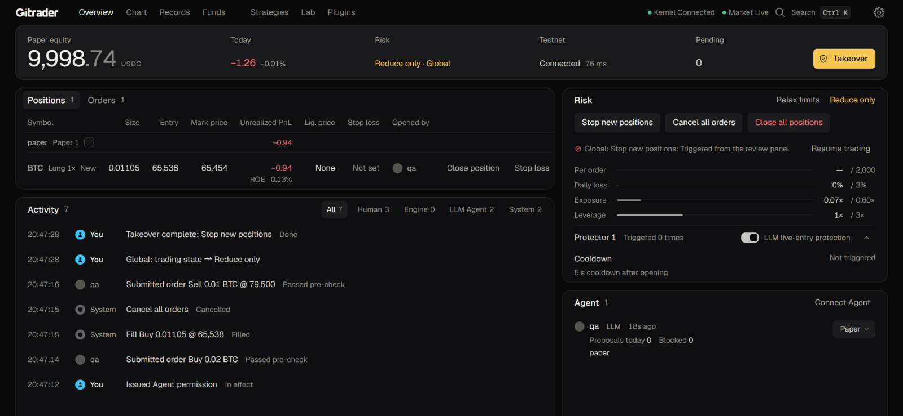

<p><picture>
  <source media="(prefers-color-scheme: dark)" srcset=".github/assets/banner-dark.png">
  
</picture></p>

**English** · [简体中文](README.zh-CN.md)

**Gitrader is an open-source AI quant trading base: embed it in any agent, and combine it with any functional trading plugin.** Plug in your own agent, engine and venues, and snap together your own AI trading workbench in minutes, brick by brick.

[](LICENSE)
[](https://nodejs.org)
[](integrations/)

## Trading is an agent skill, not a place

- **Kernel.** Paper trading, backtests and research, exposed as MCP and CLI tools. Run it on its own and let agents connect, or embed it inside one.
- **Workbench.** The screen you review: positions and PnL, agent activity and pending approvals, risk state, and an append-only ledger of who did what, when and why.
- **Plugins.** Engines in any language, venues, notifications and workbench blocks snap on through open protocols. 0.1.1 ships Hyperliquid and a paper venue fed with live market data.



## Install

```sh
npm i -g gitrader
gitrader init
gitrader serve
```

`init` creates `~/.gitrader` and asks you to set a PIN. `serve` prints a one-time workbench link that is valid for two minutes. Requires Node 22.13 or later; to skip the global install, run `npx gitrader init` and `npx gitrader serve`. `gitrader doctor` checks the setup and names the next step for anything that is not green.

No Node? Take the [portable bundle](tools/portable/README.md) for `win-x64`, `linux-x64` or `darwin-arm64` from [Releases](https://github.com/adtexterry-lgtm/gitrader/releases), with Node included, or run it in [Docker](docker/README.md). The [user guide](docs/user/en/README.md) takes it from there.

## Connect an agent

```sh
gitrader keys new agent my-agent --host claude-code --preset starter
gitrader mcp snippet claude-code --token-file <token-file> --write
gitrader skill install claude-code
```

The key is everything the agent may do: `--preset starter` asks for your PIN, keeps it to small BTC and ETH orders on Hyperliquid and has you approve every new position. Its token goes to a file only you can read; the first command prints the path, and `.mcp.json` refers to that file, never to the token. The skill teaches the agent the tools. On Codex, Hermes, Cursor or any other MCP host, swap in `codex`, `hermes`, `cursor` or `generic` and paste the printed snippet; see [integrations](integrations/).

## Open and free. No shortcuts on fund safety.

- **No custody.** Keys stay on your machine. Trading uses API wallets that can trade but cannot withdraw.
- **No strategies, data or factors.** Gitrader ships none and gives no trading advice. The strategy and the data are yours; we build the safety rails, the interfaces and the review surface.
- **A risk gate agents cannot get around.** Every order placed through the workbench passes it. Only a human with a PIN changes limits, approvals and keys; an agent can only stop new positions, cancel, flatten or downgrade itself. Orders an external engine sends straight to a venue are outside this promise, and the interface says so.
- **Plain about the edges.** Malicious code running as your own OS user is out of scope; the threat model is in [docs/security.md](docs/security.md).

0.1.1 is the first public release, a developer preview. Mainnet live trading is not supported yet and testnet live ordering is experimental; see [known limitations](docs/user/en/21-已知限制.md) and the [release notes](docs/release-notes/0.1.1.md).

## Plugins and docs

- [Plugin quickstart](docs/plugin-quickstart.md): write and run your first tool plugin in ten minutes, to the [`gitrader-plugin/1`](docs/plugin-protocol.md) spec. The plugin directory is in [docs/plugins.md](docs/plugins.md).
- [Engine protocol](docs/engine-protocol.md): connect your own engine in any language, as a local command or a remote service.
- [Write a strategy](docs/user/en/03-策略开发.md) from the blank template, then [backtest it](docs/user/en/04-回测与研究.md).
- [User guide](docs/user/en/README.md) · [Configuration](docs/config.md) · [Security model](docs/security.md) · [Changelog](CHANGELOG.md)
- [`packages/protocol`](packages/protocol/): the single source of truth for data structures, with types, JSON Schema and a conformance suite.

## License

Gitrader is [CPAL-1.0](LICENSE): open source, and the end-user interface must display **Powered by Gitrader** (Exhibit B). `packages/protocol`, `packages/blocks-sdk` and `packages/plugin-template` are Apache-2.0 and can be embedded freely, without attribution. There is no paid edition, no commercial tier and no hosted service. Third-party notices are in [THIRD-PARTY-NOTICES.md](THIRD-PARTY-NOTICES.md). Contributions are signed off under the DCO (`git commit -s`), with no separate contributor agreement; see [CONTRIBUTING.md](CONTRIBUTING.md).
