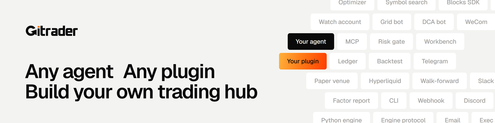
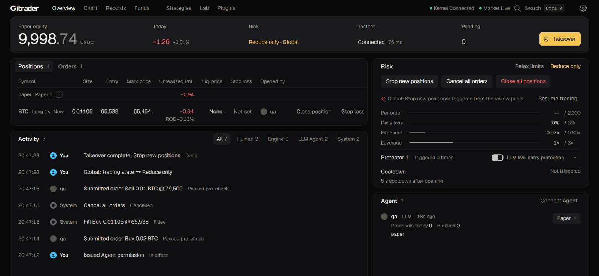

<p><picture>
  <source media="(prefers-color-scheme: dark)" srcset=".github/assets/banner-dark.png">
  
</picture></p>

[English](README.md) · **简体中文**

**Gitrader 是开源的 AI 量化交易底座：可以内嵌进任意 Agent，也可以和任意功能性交易插件组合。** 接上你自己的 Agent、引擎和交易场所，像拼乐高一样，几分钟拼出你专属的 AI 交易工作台。

[](LICENSE)
[](https://nodejs.org)
[](integrations/)

## 交易是 Agent 的能力，不是它要去的地方

- **内核。** 纸面交易、回测与研究，都以 MCP 和 CLI 工具提供。可以独立运行、让 Agent 接进来，也可以内嵌进 Agent。
- **工作台。** 给人检阅的界面：持仓与盈亏、Agent 活动与待批、风险状态，以及一本只追加的账本：谁、什么时候、做了什么、为什么。
- **插件。** 任意语言的引擎、交易场所、通知和工作台块，都按开放协议插上去。0.1.1 随包 Hyperliquid 和一个接真实行情的纸面场所。



## 安装

```sh
npm i -g gitrader
gitrader init
gitrader serve
```

`init` 建好 `~/.gitrader`，并请你设一个 PIN。`serve` 打印一条只能用一次、2 分钟内有效的工作台链接。需要 Node 22.13 或更高；不想全局安装，就用 `npx gitrader init` 和 `npx gitrader serve`。`gitrader doctor` 自检安装，每一项没绿都给出下一步。

没有 Node？到 [Releases](https://github.com/adtexterry-lgtm/gitrader/releases) 下载对应平台（`win-x64`、`linux-x64`、`darwin-arm64`）的[便携包](tools/portable/README.md)，Node 已自带；或者用 [Docker](docker/README.zh-CN.md) 跑。之后照着[用户文档](docs/user/README.md)走。

## 三行接入 Agent

```sh
gitrader keys new agent my-agent --host claude-code --preset starter
gitrader mcp snippet claude-code --token-file <令牌文件> --write
gitrader skill install claude-code
```

钥匙就是 Agent 能做的全部：`--preset starter` 要你输 PIN，只许在 Hyperliquid 上下 BTC、ETH 小额单，每笔新开仓都等你批准。令牌写进只有你本机能读的文件，第一行会打印路径；`.mcp.json` 里只写这个路径，不写令牌。第三行教 Agent 用这些工具。Codex、Hermes、Cursor 或其他 MCP 宿主，把宿主名换成 `codex`、`hermes`、`cursor`、`generic`，粘贴打印出的片段；见 [integrations](integrations/)。

## 开放、自由。资金安全，一丝不苟。

- **不托管资金。** 密钥只在你本机，交易用的是能交易、不能提现的 API 钱包。
- **不提供策略、数据、因子。** Gitrader 一样都不带，也不给交易建议。策略与数据是你自己的；我们把安全、接口和检阅做扎实。
- **经工作台的每一单都过风控，Agent 绕不过去。** 限额、批准、钥匙只能由人输 PIN 修改；Agent 只能自保：停止新开仓、撤单、全平、给自己降级。外部引擎直连场所下的单不在这条承诺里，界面会标明。
- **边界说清楚。** 同一系统用户下运行的恶意代码不在保证范围，威胁模型见 [docs/security.md](docs/security.md)。

0.1.1 是第一个公开版本，属于开发者预览。主网实盘暂不开放，测试网实盘下单仍是实验性功能；详见[已知限制](docs/user/21-已知限制.md)和[发布说明](docs/release-notes/0.1.1.md)。

## 插件与文档

- [插件快速上手](docs/plugin-quickstart.md)：十分钟写出并跑通第一个工具插件，规范是 [`gitrader-plugin/1`](docs/plugin-protocol.md)；插件目录见 [docs/plugins.md](docs/plugins.md)。
- [引擎协议](docs/engine-protocol.md)：用任意语言接你自己的引擎，本地命令或远程服务都行。
- 从空白模板[写一条策略](docs/user/03-策略开发.md)，再[回测它](docs/user/04-回测与研究.md)。
- [用户文档](docs/user/README.md) · [配置参考](docs/config.md) · [安全模型](docs/security.md) · [更新记录](CHANGELOG.md)
- [`packages/protocol`](packages/protocol/)：所有数据结构的唯一出处，含类型、JSON Schema 和一致性套件。

## 许可

Gitrader 采用 [CPAL-1.0](LICENSE)：开源，终端用户界面须显示 **Powered by Gitrader**（见 Exhibit B）。`packages/protocol`、`packages/blocks-sdk`、`packages/plugin-template` 为 Apache-2.0，可自由嵌入，不要求署名。没有付费版、没有商业层、没有托管服务。第三方声明见 [THIRD-PARTY-NOTICES.md](THIRD-PARTY-NOTICES.md)。贡献用 DCO 签署（`git commit -s`），不需要另签贡献者协议；见 [CONTRIBUTING.md](CONTRIBUTING.md)。
